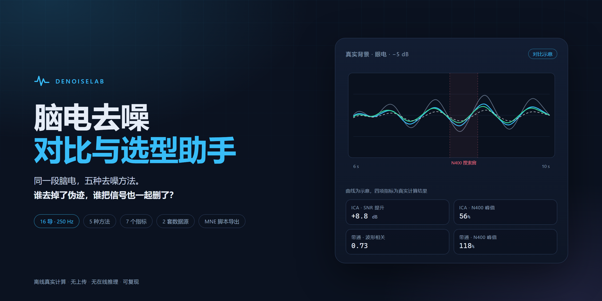

# DenoiseLab

A browser-based comparison and selection tool for EEG denoising.

**Live demo:** https://denoiselab-bkg574xl0t5.qoder.zone/



## What it does

DenoiseLab runs five common EEG denoising pipelines on the same recording and compares them side by side:

- **Bandpass** — 0.5–40 Hz zero-phase Butterworth
- **Notch** — 50/100 Hz
- **Wavelet** — db4 soft thresholding
- **ICA** — FastICA with heuristic component removal
- **ASR** — simplified low-activity calibration + subspace attenuation

For each method it shows the waveform, Welch spectrum, ERP, and seven downstream metrics: SNR improvement, waveform correlation, RRMSE, alpha/beta power retention, ERP peak ratio, and N400 latency shift. It recommends a method for the selected setup and exports an MNE script, a Methods paragraph, or a full comparison report.

Two data sources are included:

- **Synthetic EEG** — 16 channels, 250 Hz, 40 s, alpha/beta/theta rhythms plus 1/f background, 20 N400/P100 events, artifacts injected at −5/0/+5 dB.
- **Real background** — PhysioNet EEGBCI S001R02 (eyes-closed resting), resampled 160→250 Hz and normalized per channel; artifacts and ERPs are still injected.

## Run locally

No build step and no backend:

```bash
python -m http.server 8000
# open http://localhost:8000
```

All charts and metrics are precomputed offline and served as static JSON. The page never uploads data.

## Regenerate the benchmark

```bash
pip install -r requirements.txt
python tools/generate_benchmark.py
python tools/generate_real_benchmark.py
```

## Scope and limitations

- Artifacts and ERPs are injected in both datasets; ground truth is constructed.
- The real-background dataset makes the background realistic, not the artifacts or the ERP. Rankings do not transfer to real subjects — re-run the exported script on your own data and check the ERP first.
- ASR is a simplified implementation.
- Deep-learning denoisers are out of scope.

## Structure

```
.
├── index.html, styles.css, app.js   # static frontend
├── data/                            # precomputed benchmark JSON
├── tools/                           # benchmark generators
├── docs/figures/                    # design figures
└── requirements.txt
```

## Data

The real-background benchmark uses the **PhysioNet EEG Motor Movement/Imagery Dataset, S001R02**, distributed under the [Open Data Commons Attribution License v1.0](https://physionet.org/content/eegmmidb/1.0.0/). Processing details are in `tools/generate_real_benchmark.py`.

## Built with

Built with Qoder and deployed on Qoder Sites.
